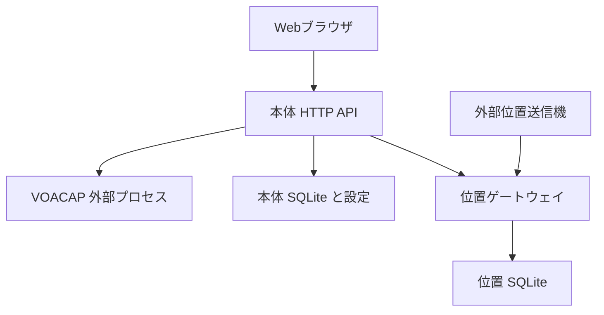

# CHUCK 開発引き継ぎ書

作成日：2026年10月16日。基準main：`863d89471a3d2e906288c4760480893d27594325`。本書追加前の機能・操作要領が揃った状態を基準とする。

CHUCKは **Coverage & HF Usability Calculation Kit** の略称。アイコンは依頼者提供のchuckさんの肖像画で、`app/static/chuck-icon.png`（ヘッダー）、`app/static/favicon.png`（ブラウザタブ）、`docs/images/chuck-icon.png`（README）に置いている。HF伝搬・通信信頼度を予察するWebシステムで、旧名称はSPARK。リポジトリ名は `UeEmon/VOCAP-COMPATIBILITY-` のまま維持している。本書は別の開発者またはAIが、実装の境界、検証状況、制約を保持して作業を再開するための資料である。

## 1 現在の到達点

- VOACAPによる24時間地点間予察、最大35地点のカバー範囲、単一TXからRX 2～8局へのサイト比較を実装済み。
- 左に循環地図、右にTX 1局・RX 1～8局。結果は地図下のタブ。クリックで局位置を移動せず、地点プリセットから選択する。
- 地点30都市、アンテナ18項目を初期登録。アンテナは5つの計算モデルと参考資料専用項目を区別する。
- 位置ゲートウェイとログイン付き管理画面、NOAA・D-RAP・NICT・任意有効化GIRO、生成AI OCR、8言語UIを実装済み。
- 日本語の操作要領は23ページ・Web画面24枚。PDF・Wordを `docs/manual/` に格納し、8言語のREADMEから参照できる。

| 対象 | 基準 |
|---|---|
| GitHub | https://github.com/UeEmon/VOCAP-COMPATIBILITY- |
| 本体画面 | http://localhost:18082 |
| ゲートウェイ画面 | http://localhost:18083 |
| 本体からの内部接続 | http://position-gateway:8001 |
| 計算エンジン | voacapl 0.7.7、上流 `c12a98b348c39f36f2659b8b3aa97b86284c8a1d` |
| 実行依存 | Python 3.12標準ライブラリ、ブラウザの素のJavaScript、Fortranエンジン |
| 最新確認 | Python 85テスト成功（実エンジン付きは84件時点でスキップなし）、実Chromiumによる回帰試験成功、Apple Silicon実機でDocker完成イメージの検証成功（2026-10-17） |

Docker完成イメージとApple Silicon（arm64）は2026-10-17に実機で検証済み（`docs/VALIDATION.md`）。arm64の再配布束も同日に生成し、最終イメージ内の全85試験がスキップなしで成功した。**Marine版との数値比較は2026-10-23に実施（11章）。差の原因は吸収モードと特定済み。次は吸収モード、SSN尺度、要求SNRの既定値の扱いを決めること。** amd64のDocker、実回線の検証完了とは扱わない。

## 2 クリーン環境での再開

Docker DesktopまたはDocker EngineとCompose v2を準備する。初回ビルドはインターネット接続が必要。

```sh
git clone https://github.com/UeEmon/VOCAP-COMPATIBILITY-.git
cd VOCAP-COMPATIBILITY-
git status --short
docker compose config --quiet
docker compose up -d --build
docker compose ps
```

本体でエンジン準備状態を確認し、東京→グアム、手動SSNで1件計算する。計算・CSV出力・再起動後の履歴復元まで確認する。AIキーや位置トークンが未設定でも固定地点の予察は使用できる。

```sh
docker compose logs --tail=100 -f
docker compose down
```

`down -v` は本体・ゲートウェイの永続データを削除する。終了や通常更新で使わない。更新時は作業内容を確認して `git pull --ff-only` 後に再ビルドする。ポート競合を避ける場合、本体は `.env` の `HF_PORT=18084` 等を使用する。18083は既定でゲートウェイが使用する。

本体の公開先は `HF_BIND`、ゲートウェイは `HF_GATEWAY_BIND` で別々に設定する。既定は127.0.0.1。本体には個別ログインがなく、LAN・遠隔公開には前段の認証・HTTPS・アクセス制御が必要。

## 3 構成と責任の境界



| ファイル | 主な責任 |
|---|---|
| `app/server.py` | HTTP API、履歴保存、出力、計算排他、各機能の連携 |
| `app/engine.py` | 入力検証、固定長カード、アンテナ一時ファイル、外部実行、生出力解析 |
| `app/gateway_client.py` と `position_contract.py` | 内部JSON v1の取得・検証、位置参照の解決 |
| `app/gateway_server.py` と `positions.py` | 外部形式の解析、局設定、最新位置、認証付き内部API |
| `app/gateway_ui.py` と `gateway_static/` | 管理パスワード、セッション、局設定・受信状態表示 |
| `app/presets.py` と `diversity.py` | カタログ保存・改訂管理、RXごとの計算と理論範囲 |
| `app/space_weather.py` と `observations.py` | 外部データ取得・正規化・キャッシュ・鮮度 |
| `app/ai_providers.py` と `antenna_ocr.py` | AI別API、設定保存、仕様抽出、原本と根拠の保存 |
| `app/static/` | 地図・条件・結果・チャート・プリセット・位置・多言語UI |
| `vendor/`、`licenses/`、`scripts/` | 固定上流ソース、第三者通知と監査ロック、配布用処理 |

本体とゲートウェイは同じDocker最終イメージから異なるPythonプログラムを起動する。本体は位置DBや外部形式パーサーを読み込まず、HTTP経由の共通レコードだけを使用する。

## 4 計算仕様と数値の扱い

エンジンのFortran計算式・係数は変更していない。CCIR／Method 30、短経路を使用する。1回のエンジン実行は60秒でタイムアウトし、API計算は1要求ずつ処理する。カバー範囲は最大35回、ダイバーシティーは最大8回の逐次実行なので、全体の所要時間は60秒に限定されない。

| 項目 | 仕様と注意 |
|---|---|
| 座標 | 入力緯度±89°、経度±180°。カードの座標は小数2桁に整形する |
| 周波数 | 2～30 MHz、最大11個。入力は0.001 MHz単位で整形・重複除去 |
| 電力 | W入力をkWへ変換。仮定した追加偏波損失は等価TX電力の低減 |
| SNR | 1 Hz換算のdB·Hz。帯域内SNRは帯域幅で換算し小数4桁に丸める |
| REL | 要求SNRを満たす月内のモデル信頼度。生出力0～1を%へ換算 |
| 雑音 | 3 MHz基準の−dBWの絶対値。150は−150 dBW |
| UTC | 生出力の24時を0時へ対応させ、0～23時に並べる |
| 欠測 | nullを維持する。REL 0やSNR 0を欠測へ置き換えない |

一時作業パスは上流の50文字制約を避けるため短い `/tmp` 配下に作る。TX/RXのアンテナファイルを別々に生成する。入力カードだけを他環境へ持ち出しても `tx.voa`／`rx.voa` は再現されないため、パラメーターと対応アンテナファイルも必要。

推奨周波数は要求REL以上の候補からREL・SNR順で選ぶ。ダイバーシティーの最良RELはサイト最大値であり、合成後の信頼度ではない。少なくとも1サイト受信の上下限と任意の独立仮定参考値を分ける。波形合成、BER、実受信機の切替は実装していない。

## 5 ゲートウェイ連接と認証

| 区間 | インターフェース |
|---|---|
| 外部→ゲートウェイ | HTTP(S) POST、局ごとにJSON／GeoJSON／NMEA 0183 RMCを選択 |
| 本体→ゲートウェイ | `GET /internal/v1/positions`、`POST /internal/v1/stations`、Bearer付き共通JSON v1 |
| ブラウザ→本体 | `GET /api/positions`、`POST /api/position-stations`。本体が代理接続 |
| 管理ブラウザ→ゲートウェイ | `/ui/api/*`、専用パスワードとセッションCookie |

`HF_POSITION_INGEST_TOKEN` と `HF_POSITION_GATEWAY_TOKEN` は各32文字以上で別値。本体用トークンは本体とゲートウェイで一致させる。管理用 `HF_GATEWAY_UI_PASSWORD` は16文字以上で両トークンと別値。管理セッションは1時間、HttpOnly・SameSite=Strict、8回の失敗で15分の試行制限。

サービスAPIは管理Cookieを認証に使わず、Origin付き直接呼出しを拒否する。内部クライアントは5秒タイムアウト、応答上限4 MiB、リダイレクトと環境プロキシを拒否。旧本体への位置POSTとゲートウェイの旧読出し経路は410。

`/api/health` はDBの生存確認で、トークン長のフラグは認証成功を保証しない。同じ値の両トークンでもフラグがtrueになり得るが、実APIは503で拒否する。本体 `/api/positions` の正常応答まで確認する。

既定の位置TTLは観測時刻から300秒。欠測・期限切れ・緯度範囲外は計算を拒否し、古いキャッシュや固定座標へ黙って戻さない。JSONのlat/lonとGeoJSONの経度・緯度順を区別する。NMEAは事前の局設定と有効RMC・チェックサムを必要とする。

本体の接続URLはComposeで固定している。別ホストへ配置するときは `environment.HF_POSITION_GATEWAY_URL` をComposeオーバーライド等で変更する。.envへの同名変数追加だけでは固定URLを変更しない。

## 6 永続化とデータ移行

| 保存先 | 内容 |
|---|---|
| `hf-data:/data/predictions.sqlite3` | predictions、station_presets、antenna_presets、revision／migration管理、antenna_documents |
| `hf-data:/data/ai-settings.json` | AI別の接続先・モデル・保存キー。権限0600、暗号化なし |
| `hf-data:/data/space-weather/` と `observations/` | 外部データと最後の取得成功時刻のキャッシュ |
| `gateway-data:/data/positions.sqlite3` | positions、position_stations。source＋identifierが複合キー |
| ブラウザlocalStorage | 入力条件と局選択、言語。本体APIキーは保存しない |

地点・アンテナ各200件、位置・局設定各2000件、OCR原本50件。履歴保存は件数無制限、一覧は最新100件。航跡は保存せず最新位置だけを保持する。観測時刻が同じ／古い再送は無視する。

カタログ・AI設定はrevisionで競合を検出する。受信移動局は地点へ自動登録するが、利用者の名称変更と明示削除を維持する。履歴再表示では計算時点の条件を復元し、現在のプリセットと異なる値は一時選択肢にする。

旧本体DBからの位置移行は `docker compose --profile tools run --rm position-migrate`。移行元を読取り専用とし、既存の移行先を上書きしない。起動中の書込みを止め、両ボリュームを保全してから実施する。

OCRの旧DBはprovider列を追加し、既存資料をopenaiとして扱う。DB変更は旧版DBと新規DBの両方で試験する。JSON／CSVの書出しだけでは原本・設定の完全バックアップにならない。

## 7 宇宙天気と観測データ

| ソース | 用途と反映 |
|---|---|
| NOAAの月別平滑SSN | 対象月に一致する観測平滑値を優先し、なければ予測平滑値。選択時は計算へ採用 |
| NOAA F10.7とR/S/G | 参考表示。自動補正なし |
| D-RAP | HAF格子と地図重畳。MUFや経路全体の損失と同一視しない |
| NICT国内4局 | F領域の距離別LUF/MUF、観測時刻と欠測。任意のTX/RX経路とは条件が異なる |
| GIRO JR055／MHJ45／GU513 | foF2、MUF(3000)、CS等。既定無効、欠測を許容 |
| ASWFC・IGS TEC | 利用候補と条件を調査済み。自動取得は未実装 |

月別SSNは6時間、現在指標・観測は基本5分キャッシュ。明示的な `refresh=1` はTTLを待たず再取得するが、失敗後60秒の再試行抑制は維持する。通信失敗では古いデータと最後の取得成功時刻を保持し、失敗状態を明示する。

観測／発行時刻と取得時刻を分ける。取得成功時刻が新しくても提供元の観測が新しいとは限らない。自動計算で期限切れSSNを採用せず503で停止する。観測値やHAFからREL/SNRを自動補正しない。

GIROを有効にする場合は利用条件を確認して `HF_GIRO_ENABLED=1` を設定する。コードMITとデータ利用条件は別。条件表示は `app/static/data-licenses.json` が編集元で、`python3 scripts/build_data_notices.py` によりMarkdown／画面を生成する。

## 8 AIと生成AI OCR

OpenAI Responses、Claude Messages、Gemini generateContent、OllamaおよびローカルOpenAI互換へ接続する。モデル一覧取得・モデル選択・AI別プロファイルを提供する。モデル一覧への掲載だけでOCR対応を保証しない。画像・構造化出力の対応確認が必要。

| AI | APIキーの環境変数 | モデルの環境変数 |
|---|---|---|
| OpenAI | OPENAI_API_KEY | HF_ANTENNA_OCR_MODEL |
| Claude | ANTHROPIC_API_KEY | ANTHROPIC_MODEL |
| Gemini | GEMINI_API_KEY、次にGOOGLE_API_KEY | GEMINI_MODEL |
| Local LLM | LOCAL_LLM_API_KEY 任意 | LOCAL_LLM_MODEL |

保存設定が環境変数より優先。キー空欄で保存すると既存値を維持し、保存キー削除で環境変数へ戻す。各社アカウントからのキー自動発行・復元ではない。キーを応答JSONやlocalStorageへ返さない。保存JSONの0600は暗号化保管ではない。

ローカルURLの既定は `http://host.docker.internal:11434`。`LOCAL_LLM_PROTOCOL=ollama/openai` を選択する。Docker内localhostは通常ホストを指さない。失敗時の別AIへの自動転送、モデル自動ダウンロードはない。

OCRはPDF・PNG・JPEG・WebP、1件8 MiB以下。ローカルは画像のみ。明示的な送信承認後、最大10候補と短い根拠を作る。原本確認後に別操作で登録し、計算使用には適切なモデル・寸法と近似承認が必要。物理長と電気長を区別し、不明値を推定しない。

原本・SHA-256・AI・モデル・根拠を保存する。開始時点のAI設定を固定し、後の設定変更で資料の出典を変えない。参照中原本の削除を拒否する。実API・実ローカル推論による精度確認は未実施。

## 9 画面とプリセットの保守

- 地図はNatural Earth同梱データのSVG表示。ドラッグで中心移動、縦／横ホイールで拡縮。倍率1と日付変更線付近も循環する。
- 地点は右側で選ぶ。TXは1局、RXは1～8局。交換は指定RXとTXだけを相互交換する。右クリックで局を動かす仕様へ戻さない。
- 結果は地図下のタブ。条件変更だけで結果を再計算しない。地図の現在入力と結果の計算時点を明確にする。
- 計算モデルはwhip、isotropic、monopole、dipole、vertical_dipole、log_periodic（Type 43）、inverted_l（Type 38）、sloping_long_wire（Type 41）、pattern_table（利得表CSVを回線方向で切り出しType 14へ変換、`app/patterns.py`）。指向性はdipole・log_periodic・inverted_l・sloping_long_wire・pattern_tableで、主放射方向は固定方位か相手局方向。寸法モデルは物理全長・設置高・主放射方位・地面定数を使用する。
- P-3用ロングワイヤーや不明な機体・艦体込みパターンは参考資料のみ。公開装備の採用・寸法・近似範囲を出典なしで拡大しない。
- `i18n-messages.js` が8言語の辞書、`i18n.js` がDOM翻訳・除外制御。利用者名、原文根拠、技術診断、ライセンス原文は安易に翻訳しない。
- サーバーが返すエラー文・注記も同じ辞書で訳す。可変部分は `{field}` などのテンプレートにし、`{note}`・`{detail}`・`{label}`・`{state}`・`{error}` の値だけは再翻訳される。外部データ説明ページ（`data-licenses.html`）は `data-licenses-messages.js` で訳す。これは各提供元条件の要約の訳で、原文はリンク先のまま。

新しい文言は全言語の値とプレースホルダーを揃え、`tests/test_i18n.py` と実ブラウザ試験を行う。同テストは静的ページの文言・属性、`app/*.py` が画面へ返す日本語文、外部データ説明の各項目が辞書にあることを確認する。UI初期化・フォームresetでhidden IDが残り、編集後の新規登録が既存行を上書きする不具合を再発させない。

ゲートウェイのセッションCookie名に残る `spark_gateway_session` は内部識別子で、CHUCK表示への改称時に互換性を維持した。改称だけを理由に保存データ・局ID・既存Cookie名まで一括置換しない。

## 10 検証の実行と結果

2026年10月16日に再実行し、実エンジン付きPython **84件成功・スキップなし**、Chromium／Playwrightのワークスペース回帰が成功した。ブラウザ試験は8言語、プリセット、地図、単一／複数RX、Propagation Chart、ゲートウェイ管理、AI設定、OCR登録を含む。AI応答とモデル一覧はfixtureであり実クラウドの成功ではない。

```sh
python3 -m unittest discover -s tests -q
node --check app/static/app.js
node --check app/static/i18n-messages.js
```

ネイティブ実エンジン試験は環境変数を指定する。

```sh
VOACAP_BIN=/path/to/voacapl VOACAP_MODEL=/path/to/itshfbc \
python3 -m unittest discover -s tests -q
```

ブラウザ試験には開発専用のPlaywrightとChromium、Node.jsを別途用意する。これらをアプリ実行依存や配布物に混ぜない。

```sh
VOACAP_BIN=/path/to/voacapl VOACAP_MODEL=/path/to/itshfbc \
HF_UI_BROWSER=/path/to/chromium node tests/ui_workbench.cjs
```

エンジン未指定での成功表示にはスキップが含まれ得る。リリース判断では件数とスキップ数を記録する。`docs/VALIDATION.md` の各節は当時の履歴であり、古い「ブラウザ未検証」を現在の総合状態と取り違えない。最終イメージ内の `compare_voacap.py` はarm64で成功した。Docker内の全テストは再配布束の生成で85件スキップなしを確認した。ブラウザ試験のarm64実行は未実施。

## 11 VOACAPとの比較

比較は、同梱VOACAPを別に直接実行した値と、CHUCKのHTTP APIの値を照合したもの。入力カードは別構築、基準出力も独立の解析処理で読んだ。同じエンジンと係数を使うため、これは入力変換・解析・API経路の整合試験である。

条件：2026年10月、SSN 80、150 W、標準ホイップ双方、利得補正0、雑音−150 dBW、最低角3°、要求SNR 40 dB·Hz、要求REL 90%。東京からグアム・ホノルル・ロンドンへ、4／6／8／12／16 MHzの24時間を比較。

| 比較 | 結果 |
|---|---|
| 3経路×5周波数×24時間 | 360点。欠測状態の食違いなし |
| REL、SNR、受信信号、打上げ角 | 最大差すべて0 |
| 経路MUF | 72時刻で最大差0 MHz |
| 12 UTC・8 MHz 東京→グアム | 両方 REL 71%、SNR 45 dB·Hz |
| 同 東京→ホノルル | 両方 REL 53%、SNR 41 dB·Hz |
| 同 東京→ロンドン | 両方 REL 0%、SNR 0 dB·Hz |

過去の付属Windows基準出力 `vendor/tests/p2p/test01.out` と現行エンジンの別比較では、最大差REL 1ポイント、受信信号1 dB、打上げ角0.1°、MUF 0.1 MHz、SNR 0 dB。原因は丸め境界付近の値の印字差と切り分け済み（`docs/VALIDATION.md` 2026-10-17）。比較スクリプトは末位1単位を許容差として判定する。過去基準の500 kW条件を本体の上限100 kWへ黙って縮小して比較していない。

再現スクリプトは `scripts/compare_voacap.py`、記録は `docs/validation/voacap-comparison.json`。エンジンの環境変数を指定して実行する。Marineオンラインサービスとの比較は2026-10-23に実施した（`docs/VALIDATION.md`、`scripts/compare_marine.py`）。標準設定ではREL差が87%の点で5ポイント以内、低い周波数の夜間側でCHUCKが最大45ポイント低い。原因はエンジンの吸収モードで、Marineは `--absorption-mode=a`（Alexの改良＋IONCAPの吸収）に相当し、CHUCKは指定なし（W）。`a` で計算すると全2160点が完全に一致する。実測に対する予測精度検証は未実施。

```sh
VOACAP_BIN=/path/to/voacapl VOACAP_MODEL=/path/to/itshfbc \
python3 scripts/compare_voacap.py --output-dir dist/voacap-comparison
```

出力先には基準カード・生出力・CHUCKのJSON・summary.jsonを保存する。同じ出力先の再実行は同名ファイルを更新する。3経路比較の差、欠測不一致、または過去Windows基準との差が末位1単位を超えた場合に終了コード1。

## 12 未完了事項と優先順位

| 優先 | 項目 | 完了と判断する条件 |
|---|---|---|
| 済 | Docker完成イメージ | 2026-10-17、arm64実機でclean cloneからbuild、両サービス起動、計算、CSV、履歴再読込、イメージ内比較を確認 |
| 済 | Apple SiliconとARM64 | 2026-10-17、実Macでarm64ビルド・ライセンス監査・主要APIを確認。画面のブラウザ試験はarm64未実施 |
| 済 | 再配布束の実生成 | 2026-10-17、arm64でライセンス監査・対応ソース・最終image内85試験（スキップ0）・SHA一覧を確認。amd64束は未生成 |
| P1 | 有料AIとローカル推論 | 権限のある実資料で各AIの画像・PDF可否、モデル選択、料金・失敗を確認 |
| P1 | 実位置入力と遠隔HTTPS | GNSS等の実送信元、UTC同期、期限、認証、前段TLSとCookieを確認 |
| 済 | Marine版との数値比較 | 2026-10-23、Isotrope 0 dBiで10条件2160点を比較。差の原因は吸収モード（Marineは `a`、CHUCKは W）と特定し、`a` で全点一致を確認。ホイップ比較はMarine側エラーで未実施 |
| P1 | 吸収モード | CHUCKを `--absorption-mode=a` に切り替えるか、選択式にするかを依頼者と決める。夜間の低い周波数の予測が変わる |
| P1 | SSN尺度と要求SNRの既定値 | Marineは入力SSNを0.7倍し、要求SNRをCW 19／SSB 39／AM 48とする。CHUCKの扱い（無換算、例示値24/45/67）を変えるかを依頼者と決める |
| 済 | 過去基準の微差分析 | 2026-10-17、全135差分が丸め境界付近の末位1単位と確認。許容差を末位1単位として比較スクリプトに組込み |
| P2 | 国外観測の追加 | ASWFC／IGS等の利用条件、取得形式、欠測、鮮度を確認後に個別実装 |

未実装：生TCP／UDP・シリアル、AIS／ADS-B／NMEA2000の直接デコード、移動経路追跡予察、航空機高度補正、機体・艦体パターン推定、偏波伝搬モデル、観測による自動補正、実受信切替制御。本体のアカウント管理や暗号化キー保管もない。

現行Dockerはパッケージ差異を監査で停止する設計。APT配布版の変化でビルドが止まっても、監査を無効化して通さない。digest・パッケージ版・対応ソース・通知をまとめて再評価する。

## 13 ライセンスとリリース

新規本体コードはMIT。エンジン・補助ツール・Python・Debianランタイム・地図・外部データは個別条件。`SOFTWARE_LICENSES.md`、`THIRD_PARTY_NOTICES.md`、`DATA_LICENSES.md`、`vendor/LOCAL_CHANGES.md` を保持する。

Dockerの固定Pythonベースと、amd64 107／arm64 106のパッケージ版・原文通知ハッシュを `licenses/runtime-license-lock.json` で照合する。未監査差異、通知欠落、対応ソース不足では停止する。pip・ensurepip等の未使用インストーラーは最終イメージに含めない。

再配布根拠が十分確認できなかった上流ロゴとマニュアルを現行ソースから除外済み。計算ソースや係数は変更していない。過去Git履歴を含めた一括配布と、現行treeからの配布を混同しない。

```sh
python3 scripts/build_redistribution.py dist/redistribution
```

Dockerが必要で、作業ツリーがクリーンでなければ停止する。最終イメージ内監査・全テストを実行し、スキップも失敗扱いとする。実行イメージ、同じコミットのソース、対応ソース、通知、ハッシュを含む生成ディレクトリ全体を配布する。現時点でこの配布束の完成は未検証。

GIROは既定無効を維持し、非商用・共有等の条件を確認する。NOAA経由の第三者由来SSNやNICTも一律の無制限再配布としない。APIキー、位置DB、資料原本、履歴、キャッシュ、データボリュームを配布束へ入れない。

## 14 引き継ぎ後の最初の作業

1. GitHubから新規cloneし、基準コミットと差分を確認する。この作業環境の一時パスや事前ビルド済みバイナリの存在を前提にしない。
2. 操作要領と本書を読み、DockerとApple Siliconの未検証事項を確認する。
3. 本体・ゲートウェイを起動し、固定局1件、複数RX、カバー、プリセット、再起動後履歴を確認する。
4. 必要に応じ別値のトークンと専用パスワードを設定し、本体→ゲートウェイの実API応答を確認する。
5. テスト84件、ブラウザ、VOACAP比較を再現し、環境・コミット・件数・スキップ数・差分を記録する。
6. P0から着手し、既存仕様の変更は理由と互換性を文書化する。検証記録の追記とREADME・多言語文言・操作要領の更新要否を確認する。

GitHub操作は通常の認証済みGit環境で行う。前の作業環境ではCLIのHTTPS push資格情報がなく、接続済みGitHub APIでblob→tree→commitを作成し、mainの期待SHAを指定して更新した。新環境はGitHubのmainを正とし、古いローカル履歴をforce pushしない。

| 目的 | 参照文書 |
|---|---|
| 操作 | `docs/manual/CHUCK_Operation_Manual_ja.pdf` とWord版 |
| APIと単位 | `docs/API.md`、`docs/GATEWAY_PROTOCOL.md`、`docs/POSITION_INTERFACE.md` |
| AIとアンテナ | `docs/AI_SETTINGS.md`、`docs/ANTENNA_OCR.md`、`docs/ANTENNA_PRESETS.md` |
| 観測とサイト比較 | `docs/SPACE_WEATHER.md`、`docs/INTERNATIONAL_IONOSPHERE.md`、`docs/RX_DIVERSITY.md` |
| 試験と配布 | `docs/VALIDATION.md`、`docs/REDISTRIBUTION.md` |

次の担当者への指示例：本書と現在のmainを基準にCHUCKを再開する。最初にDocker Desktop／Apple Siliconでclean buildと本体・ゲートウェイの実接続を確認し、結果を残す。実装済み機能を新規仕様として作り直さず、未検証・未実装の区別を維持する。

## 新機能のお知らせ

利用者向けの新機能を追加したら、`app/static/whats-new.json` の先頭に1件と、その翻訳を追加する。手順は[WHATS_NEW.md](WHATS_NEW.md)。
